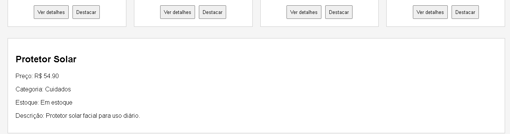
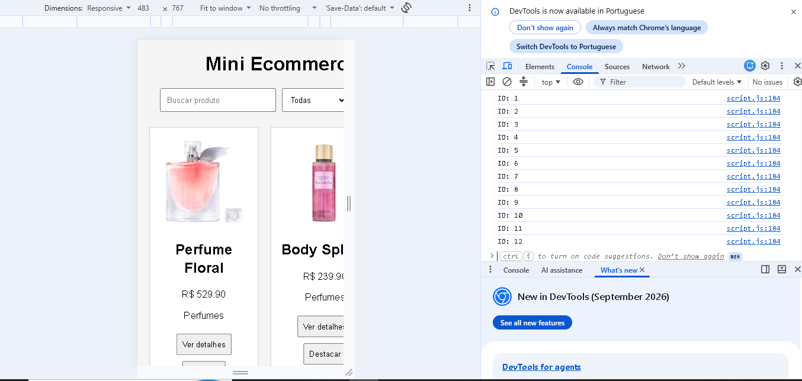

# Atividade Prática - Funções e DOM

## Mini Ecommerce

Atividade desenvolvida para praticar funções em JavaScript e manipulação do DOM.

### Aluna
Ana Carolina Viana Ribeiro

### Matrícula
935888

## Tela da aplicação

## Console

Saída dos IDs dos produtos utilizando `querySelectorAll`.

